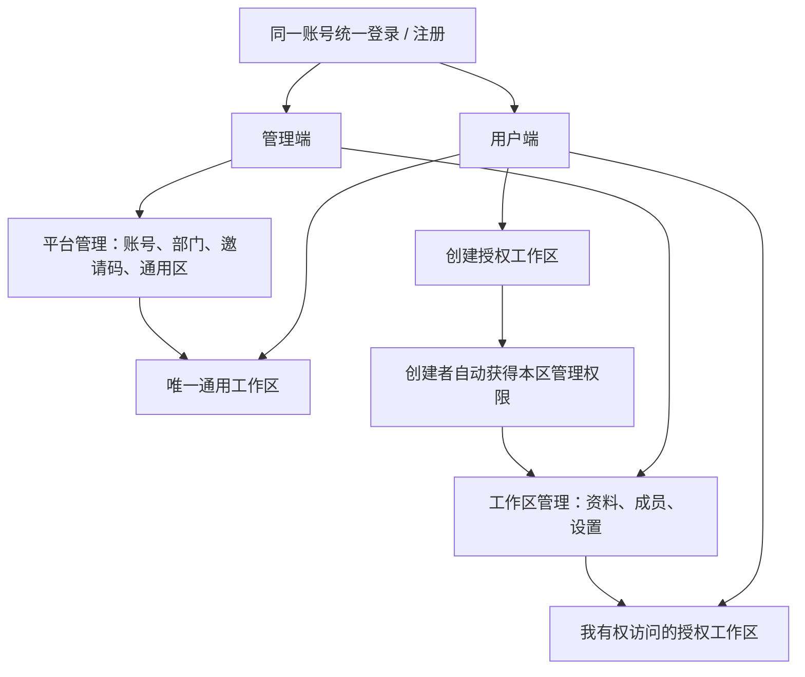

# 库解：双端账号与工作区权限完整规划

日期：2026-11-11（Asia/Shanghai）

状态：实施中（P0 基线已部署；P1 账号与会话接口已部署，首个平台管理员初始化待安全交互执行；P2 工作区权限核心开发中）；本文件定义已确认需求、实施规则与验收标准。

## 1. 已确认的需求

| 项目 | 已确认规则 |
| --- | --- |
| 两个端 | 同一账号可同时使用用户端和管理端，共用账号、密码、登录会话和知识库后端 |
| 登录 | 账号、密码登录 |
| 注册 | 必须填写平台管理员生成的全局邀请码 |
| 邀请码 | 6 位数字和字母，可重复使用，平台管理员可重置；重置不影响已有账号 |
| 通用工作区 | 只有一个，所有正常登录用户都可检索，由平台管理员管理资料 |
| 授权工作区 | 可以有多个，只有获授权的人可检索，可按部门分配 |
| 创建授权区 | 所有正常登录用户均可创建，创建者自动成为该区管理员 |
| 分权 | 谁创建授权工作区，谁自动成为该区管理员；同一账号在不同工作区可有不同权限，创建工作区不提升平台管理权限 |

以下具体数值、页面安排和边界是本规划采用的建议默认值，实施时以本文件作为统一依据；业务上新增要求通过修订本文件记录。

## 2. 首版产品结构

采用一个 React 前端项目、一个 FastAPI 后端和一个公开站点，通过路径区分两端。用户端和管理端是同一账号的操作入口，共用一次登录；同一个人无需另建管理员账号或密码，登录页不要求选择身份。管理端菜单依据权限显示，后端对每项操作独立鉴权。

管理端包含“工作区管理”和“平台管理”两组能力。普通用户可以进入“我的管理工作区”；平台管理菜单和接口只对平台管理员开放。

例如同一个账号创建了 A 区，又被别人授权读取 B 区：它在 A 区是管理员，在 B 区是阅读者，在没有授权的 C 区无权访问。该账号可以在问答和管理入口之间切换，无需退出登录或另建账号。

## 3. 统一账号与分层权限

### 3.1 同一账号的平台权限标记

- `user`：账号的基础权限，可以检索有权资料、管理自己的会话、创建授权工作区。
- `platform_admin`：在同一账号上增加平台管理能力，包括账号、部门、邀请码、通用区和全平台授权区的监管与接管，同时保留用户端能力。
- 两者是同一套账号上的权限标记，不是两类独立注册身份；共用账号密码，私人历史统一归同一用户 ID。
- 注册创建的账号固定为 `user`；请求中传入其他平台身份、部门或任意创建者字段均不能获得权限。
- 允许存在多个平台管理员；必须保留至少一个启用的平台管理员。
- 平台管理员的全局管理能力包括授权区资料管理和接管，相关操作记审计；该能力不包含读取其他用户私人聊天。

### 3.2 授权工作区内身份

授权区的基本规则是“谁创建，谁就是这个工作区的管理员”。创建成功后服务器自动给创建者本区管理权限，不需要额外申请、另建管理员账号或由平台管理员再提权。本区管理员仍使用原账号在用户端提问、检索，在管理端维护本区。

| 身份 | 能力 |
| --- | --- |
| 负责人 | 本区管理员全部能力，以及转交负责人、归档本区、管理管理员身份 |
| 工作区管理员 | 本区资料管理、阅读成员管理、部门阅读授权、名称和说明修改、本区索引维护 |
| 阅读者 | 本区检索、资料列表、内容、预览、下载 |
| 禁止访问 | 明确排除该用户，覆盖部门继承的阅读权限 |
| 跟随部门 | 没有个人覆盖；是否可读取决于部门授权 |

每个授权工作区有一个当前负责人，可有多个管理员。`created_by` 记录不可变的历史创建者，`owner_user_id` 记录可转交的负责人。负责人同时具有本区管理员成员记录，两者在事务中保持一致。

负责人由创建者担任。普通本区管理员不能降级、移除或禁止负责人，也不能更改其他管理员身份；新增和撤销本区管理员由负责人或平台管理员执行。这样委派资料管理不会自动授予接管本区的能力。

## 4. 账号、密码和邀请码的具体要求

### 4.1 账号字段

| 字段 | 具体规则 | 注册界面提示 |
| --- | --- | --- |
| 登录账号 | 3～32 个字符；仅英文字母、数字、下划线 `_`、短横线 `-`；首字符必须是字母或数字 | 3～32 位字母、数字、下划线或短横线 |
| 大小写 | 去除账号首尾空格后转小写保存和比较；`ZhangSan` 与 `zhangsan` 是同一账号 | 账号不区分大小写 |
| 重名 | 数据库唯一约束；大小写变体同样算重复 | 该账号已被使用 |
| 保留账号 | `admin`、`root`、`system`、`support` 等系统保留名称不能自行注册；初始化命令可创建指定管理员账号 | 该账号名称不可注册 |
| 账号更改 | 首版注册后不更改登录账号；停用的账号名称不重新分配给其他人 | 账号创建后不可修改 |
| 显示名称 | 可选，2～30 个字符，可用中文；未填写时显示登录账号 | 可填写姓名或常用名称 |
| 部门 | 注册时不由用户决定实际所属部门；平台管理员分配；默认未分配 | 注册后由管理员分配部门 |
| 平台角色 | 注册固定为普通用户 | 无角色选择字段 |

员工号或学号可以作为登录账号，只要符合上述字符和长度规则。账号内部标识使用服务器生成的稳定用户 ID，文档归属和权限不依赖可显示名称。

### 4.2 密码规则

本系统首版是账号密码单因素登录，建议采用以下统一规则。长度采用 15 个字符下限，参考 [NIST 密码校验要求](https://pages.nist.gov/800-63-4/sp800-63b.html#passwordver)。

| 项目 | 具体规则 |
| --- | --- |
| 长度 | 普通用户、工作区管理员和平台管理员统一为 15～128 个字符 |
| 可用字符 | 可打印字母、数字、符号、空格和中文；拒绝换行、制表符及不可见控制字符 |
| 长度计算 | 前后端统一按 NFC 规范化后的 Unicode 码点数量计算 |
| 大小写和空格 | 密码区分大小写；不自动去掉首尾空格，不转小写，不截断；注册与登录使用同一规范化规则 |
| 字符组合 | 不强制必须同时有大写、小写、数字和符号；允许使用足够长的口令短语 |
| 弱密码拦截 | 拒绝常见泄露密码、常见弱口令，以及账号本身或明显的账号拼接形式；使用本地阻止清单 |
| 确认密码 | 注册和本人主动改密时必须二次输入并一致 |
| 输入体验 | 支持显示/隐藏密码、粘贴和密码管理器；前后端均校验，不能只靠前端提示 |
| 定期修改 | 不默认强制按月更换；发生泄露或安全处置时要求更换 |
| 存储 | 使用 Argon2id 加独立随机盐的密码哈希；不保存可还原密码，不在日志或接口返回密码 |

Argon2id 参数至少满足当前 [OWASP 密码存储建议](https://cheatsheetseries.owasp.org/cheatsheets/Password_Storage_Cheat_Sheet.html)，部署机上测量登录成本后确定参数；哈希保存算法和成本信息，后续可在正常登录时升级。

新密码不能与当前密码相同。首版不增加历史密码强制定期轮换，也不将用户输入的密码发往第三方服务做明文检测。

### 4.3 本人改密与管理员初始化

- 自己改密：输入当前密码、新密码、确认密码；验证成功后撤销该账号所有旧登录会话，要求使用新密码重新登录。
- 本轮明确的管理员重置功能是注册邀请码，按第 4.5 节执行；管理员端重置用户密码不纳入首版需求。
- 用户在注册时自行设置密码；平台管理员和工作区管理员均不能查看用户现有密码。邀请码重置不修改账号密码。
- 首个平台管理员通过服务器交互命令创建，输入账号、密码和确认密码；没有内置通用密码，没有公开管理员注册入口。
- 忘记密码首版通过受服务器权限保护的运维恢复流程处理，核实账号归属并记录恢复事件，恢复成功撤销旧登录；不使用邀请码恢复密码或认领既有账号。
- 首版不增加短信、邮箱自助找回及管理员端重置用户密码页面。

### 4.4 登录失败和会话

- 登录失败统一提示“账号或密码错误”；不向错误密码请求泄露该账号是否存在、所属部门或角色。
- 建议初始限流：同账号与来源 IP 组合 15 分钟内连续失败 5 次，冷却 15 分钟；单账号跨来源和单 IP 总请求另设较高阈值，避免绕过或校园共享网络被长期整段封禁。阈值配置化，平台管理员可解除临时限制。
- 注册猜邀请码、创建工作区及高成本检索分别限流；不能依靠前端按钮禁用控制请求量。
- 会话采用随机不可预测令牌，数据库只存令牌摘要；Cookie 设置 `HttpOnly`、明确的 `SameSite=Lax`，HTTPS 生产环境开启 `Secure`。相关设计参照 [OWASP 会话管理](https://cheatsheetseries.owasp.org/cheatsheets/Session_Management_Cheat_Sheet.html)。
- 默认绝对有效期 12 小时，闲置有效期 2 小时，均可配置；刷新页面先向后端恢复身份。会话数据不放入 localStorage。
- 允许多个设备登录；提供退出当前登录和退出全部设备。停用、改密、平台角色变更撤销会话；工作区授权变化更新权限版本，不将新的权限继续信任给旧缓存。
- 受保护写请求使用会话绑定的 CSRF Token，并校验来源；登录、注册请求也检查同源及内容类型。`SameSite` 作为补充，按 [OWASP CSRF 指南](https://cheatsheetseries.owasp.org/cheatsheets/Cross-Site_Request_Forgery_Prevention_Cheat_Sheet.html) 实施。

### 4.5 六位全局邀请码

- 字符集为 `A-Z` 和 `0-9`，固定 6 位，使用密码学安全随机数；输入去除首尾空格并转大写后验证。
- 同一时刻只有一个有效全局邀请码，可被多人重复使用，默认没有自动到期或总使用次数限制。
- 平台管理员首次生成后才能开放注册；可以独立关闭注册，关闭后即使知道现有码也不能注册。
- 管理员在“注册设置”点击“重置邀请码”，确认后生成一个不同于旧码的新六位码，旧码立即失效。新码只在生成/重置成功时显示一次并可复制。平时展示“已配置”、更新时间及操作者，丢失后通过重置生成新码。
- 数据库存带服务器密钥的摘要，不记录邀请码明文；普通用户和工作区管理员没有生成、读取、重置全局邀请码的权限。
- 验证邀请码与创建账号在同一事务中处理；重置成功返回之后发起的注册不能继续使用旧码。邀请码变化不修改已注册账号、密码、部门或已有工作区权限，也不使已有登录失效。
- 邀请码是注册门槛，不作为登录密码、工作区加入码或资料访问凭据。

## 5. 工作区和成员权限规则

### 5.1 通用工作区

- 系统始终保留一个通用区，尽量保留既有 `campus-default` ID，以减少原件路径、片段和引用迁移。
- 所有启用且正常登录的用户可检索、浏览、预览和下载；用户不能被单独禁止通用区。
- 只有平台管理员可以上传、删资料、维护索引和修改通用区设置。
- 数据库唯一约束加服务端保护保证不能创建第二个通用区；通用区不能归档、删除或改为授权区。

### 5.2 创建授权工作区

所有启用、已完成注册并正常登录的用户均可创建授权区。表单只包含名称（1～50 字）和说明（0～500 字）；名称允许重复，身份依赖服务器生成的 ID。

创建事务必须同时写入工作区、创建者/负责人、本区管理员成员、权限版本及审计。任何一步失败整体回滚。客户端不能指定通用区类型、其他创建者、平台管理员角色或冒用他人负责人。

创建者身份由当前登录会话确定；不能用客户端传入的用户名、角色选择或另一个账号替代。创建成功即可切换到本区管理界面，登录会话保持不变。

默认只有创建者及平台管理员可以访问新授权区，不自动向创建者部门或所有注册用户共享。创建后直接进入本区资料管理页，可上传资料、加入成员或授予部门阅读权限。

首版不擅自限定每人只能创建一个。创建限流、文件大小及存储使用监控属于平台配置；未来如启用数量/容量配额，应有明确额度和界面提示。

### 5.3 权限判定顺序

每个用户可属于一个主部门；一个部门可以阅读多个授权区，一个授权区也可以向多个部门开放。部门授权只产生阅读权限。

对授权区按以下顺序决定最终权限：

1. 账号停用或会话失效：拒绝正常业务访问。
2. 平台管理员：拥有全局治理和管理能力，含归档区恢复。
3. 工作区已归档：退出普通检索和资料访问范围；本区负责人/管理员仅能查看管理状态，资料恢复访问需先恢复工作区。
4. 当前负责人或直接成员 `admin`：本区管理和读取。
5. 直接成员 `blocked`：禁止访问，覆盖部门授权。
6. 直接成员 `reader`：允许读取。
7. 没有直接成员记录且所在部门获授权：允许读取。
8. 其余：无权限。

同一用户和工作区只有一个个人设置，`admin / reader / blocked` 互斥；“跟随部门”表示没有该直接成员记录。负责人不能通过普通成员编辑接口被禁止，必须先完成转交。

权限必须由后端在每次请求中计算，不能由浏览器工作区列表或随机 ID 代替。实施遵循 [OWASP 授权指南](https://cheatsheetseries.owasp.org/cheatsheets/Authorization_Cheat_Sheet.html) 的逐请求检查和默认拒绝规则。

### 5.4 权限矩阵

| 操作 | 未登录 | 普通阅读者 | 本区管理员 | 本区负责人 | 平台管理员 |
| --- | --- | --- | --- | --- | --- |
| 邀请码注册/账号密码登录 | 可按规则使用 | 可退出后注册/登录 | 同左 | 同左 | 同左 |
| 通用区读取 | 否 | 是 | 是 | 是 | 是 |
| 授权区读取 | 否 | 按该区权限 | 仅自己有权区 | 仅自己有权区 | 全部 |
| 创建授权区 | 否 | 是 | 是 | 是 | 是 |
| 通用区资料写入/索引维护 | 否 | 否 | 否 | 否 | 是 |
| 授权区资料写入/本区索引维护 | 否 | 否 | 仅本区 | 仅本区 | 全部 |
| 本区个人阅读授权、禁止、部门阅读授权 | 否 | 否 | 仅本区 | 仅本区 | 全部 |
| 增加/撤销本区管理员 | 否 | 否 | 否 | 仅本区 | 全部 |
| 本区名称和说明 | 否 | 否 | 仅本区 | 仅本区 | 全部 |
| 本区转交、归档、恢复 | 否 | 否 | 否 | 仅本区 | 全部 |
| 平台账号/部门/邀请码管理 | 否 | 否 | 否 | 否 | 是 |
| 全平台集合建立、物理清理 | 否 | 否 | 否 | 否 | 平台管理员/运维 |
| 私人聊天历史 | 否 | 仅本人 | 仅本人 | 仅本人 | 仅本人 |

### 5.5 转交、退出和停用

- 负责人可以将本区转交给现有的启用本区管理员；目标尚未加入时先授予本区管理员身份。
- 转交在锁定工作区的事务中完成，新负责人和成员身份同步更新；原负责人默认保留本区管理员，退出需另行操作。
- 负责人不能直接退出或降级自己；任何自行移除管理员的变更均要保留至少一个启用本区管理员。并发操作也执行同一约束。
- 平台管理员可紧急停用任何工作区负责人，即使其是某区唯一管理员；停用会撤销本人会话和在途操作，保留其工作区和资料。若目标同时是最后一个启用的平台管理员，必须先在同一受控操作中建立或启用另一平台管理员；日常接口不得绕过该约束。
- 负责人停用后工作区标记“负责人待接管”。其他启用本区管理员继续按原权限管理；若没有其他启用管理员，则仅平台管理员可处理管理操作。既有阅读成员保留读取权限，不自动加入其他用户。
- 平台管理员可审计接管并指定启用用户为新负责人；不会根据用户名相同或部门变化自动认领。
- 用户转部门前展示最终权限差异。部门继承随所属部门变化；已有个人阅读授权、管理身份和自己创建的区默认保留，并明确列给平台管理员检查，避免把“调部门”等同于“全部权限清空”。
- 授权区首版采用归档与恢复；整区永久删除交由后续专门清理流程。归档不删除原件、片段、向量和操作记录。

## 6. 用户端页面与流程

| 路径 | 页面 | 主要内容 |
| --- | --- | --- |
| `/login` | 登录 | 账号、密码、显示密码、注册入口、错误和冷却提示 |
| `/register` | 注册 | 账号、显示名称、密码、确认密码、六位邀请码 |
| `/account/change-password` | 本人改密 | 当前密码、新密码、确认密码 |
| `/app` | 问答 | 检索范围、提问、来源、个人历史、创建授权区、管理入口 |
| `/app/documents` | 可读资料 | 当前范围资料列表、文件名筛选、预览和下载 |
| `/account` | 我的账号 | 显示名称、账号、部门、修改密码、退出当前/全部设备 |

### 6.1 默认检索范围

范围选择器提供“全部可用资料”（默认）、“通用知识库”和当前有权授权区。工作区按“我管理的”“我可读取的”分组，并显示通用/授权标签。

默认的全部范围由服务器展开为当前可读工作区集合。选择单一区时仅检索该区，界面明确显示范围；不会暗中增加其他区。引用显示所属工作区名称和原始资料，链接仍需权限检查。

一个对话固定绑定全部范围或一个单区范围。切换范围后进入该范围的会话列表/新会话，避免将其他范围的聊天上下文直接续入。

### 6.2 创建和管理入口

所有启用用户可点击“创建授权工作区”。创建成功自动获得本区管理身份，进入管理端的该区资料页；“返回问答”进入新建区的单区会话。

用户问答页面专注检索和阅读，资料上传、粘贴文件、拖放上传、删除、重建等写操作统一放在工作区管理页。具备管理权限的用户在所选区看到“管理本区”快捷入口。

### 6.3 账号与请求状态

- 所有账号使用统一登录页，默认进入用户端；直接访问管理地址时，登录后按权限返回目标页面。用户端和管理端提供“管理我的工作区 / 返回问答”入口，切换时不重新登录、不复制账号或私人会话。
- 页面刷新先请求当前身份，再装载个人会话和范围，防止上一账号内容短暂闪现。
- 退出或切换账号时清内存状态、中止 SSE 和旧请求、停止轮询，旧回调不能写入新账号页面。
- 在任一端退出，另一端共享的登录会话同样失效；两端不能分别残留不同的登录身份。
- `401` 统一返回登录；保留必要的页面返回路径，但不能将别人的聊天内容装入新账号。
- `403` 表示当前无权，刷新工作区列表并提示权限变更；不自动扩大查询范围继续回答。
- 个人偏好按用户保存；产品 API 地址固定同源，不允许用户随意改后端地址。
- 界面延续现有库解 Logo、浏览器标题、暖白与紫色视觉；登录页、管理页和移动端使用同一套样式。

## 7. 管理端页面与操作

`/admin` 对平台管理员进入用户管理，对其他启用用户进入“我的管理工作区”。没有管理区时显示创建入口。全局页面另有平台权限守卫，本区页面另有本区管理权限守卫。

不能用“不是平台管理员”直接阻止整个管理端：普通账号创建的工作区也必须能够管理。每次进入具体工作区都依据该账号与目标工作区的关系检查权限。

| 页面 | 可使用者 | 内容 |
| --- | --- | --- |
| 我的管理工作区 | 所有启用用户 | 我负责/我管理的区，创建授权区，状态与管理入口 |
| 工作区资料 | 本区管理员/负责人、平台管理员 | 上传、解析/索引进度、列表、预览、下载、删资料、本区重建 |
| 工作区成员 | 本区管理员/负责人、平台管理员 | 个人角色、部门阅读授权、最终权限与来源 |
| 工作区设置 | 本区管理员/负责人、平台管理员 | 名称、说明；负责人可转交/归档/恢复 |
| 用户管理 | 平台管理员 | 搜索、部门、平台身份、状态、个人授权、退出会话、待接管区 |
| 部门管理 | 平台管理员 | 建立/改名部门、成员分配、授权关系概览 |
| 通用知识库管理 | 平台管理员 | 唯一通用区的资料和索引 |
| 注册设置 | 平台管理员 | 开关注册、生成/重置邀请码、复制新码、更新时间 |
| 操作记录 | 平台管理员；本区管理者限本区 | 授权、账号、转交、邀请码和资料变更记录 |

### 7.1 成员授权界面

个人成员和部门授权分开显示。个人表展示账号、显示名称、最终角色、权限来源和个人设置。个人设置是单值：跟随部门、阅读者、管理员、禁止访问；负责人单独显示且不能普通改选。

“取消个人覆盖”按钮使用“恢复跟随部门”，并预览最终结果，避免用户仍有部门权限却误以为已完全移除。工作区管理员只能调整阅读者/禁止/继承；管理身份由负责人或平台管理员调整。

本区管理者通过准确账号查找已注册启用用户，接口只返回加入所需的最少资料，不暴露全平台用户清单或其他区权限。部门授权仅选择已存在部门，不能据此修改部门定义或成员归属。

### 7.2 保存、确认和并发

授权变更保存前显示将新增/失去权限的工作区或受影响人数。转交、归档、删除资料和重置邀请码有明确的二次确认；不重复弹多层确认。

授权和成员表保存携带版本号，两个管理者同时修改时返回 `409` 并要求刷新，不静默覆盖。失败时保留表单，成功后重新获取后端最终权限。

## 8. 后端模块和持久化

复用现有 FastAPI 和 SQLAlchemy。账号权限默认写入仓库外的 `data/auth/auth.sqlite3`，并支持通过 `AUTH_DATABASE_URL` 切换到 MySQL；数据库和邀请码密钥均不进入 Git。为账号权限建立必需持久化模块和版本化迁移。权限库不可用时受保护接口拒绝访问，不能回退到匿名、内存账号或默认通用区。当前服务使用单个 Uvicorn worker；扩大为多进程或多机部署前，切换到共享 MySQL 并验证迁移与会话一致性。

首个账号权限迁移记录在 `auth_schema_migrations`。邀请码 pepper 默认首次运行时生成在 `data/auth/invite.key` 并限制为仅服务账号可读写；备份时必须与账号数据库一并保护。密钥更换会使旧邀请码无法验证并导致旧 CSRF 校验失效，账号密码和用户数据仍保留，平台管理员可重置邀请码并要求用户重新恢复会话。

建议拆分模块：身份与会话、平台用户/部门、工作区权限策略、文档与任务、个人对话、审计。现有问答内容安全 `security.py` 与账号鉴权职责分别保留。

### 8.1 数据实体

| 实体 | 主要字段/约束 |
| --- | --- |
| `users` | 唯一账号记录：稳定 ID、规范化账号、显示名称、密码哈希、平台权限标记、部门、状态、权限版本、时间；不另建管理员账号表 |
| `departments` | ID、名称、状态、版本；归档前处理成员关系 |
| `workspaces` | ID、名称、类型、状态、`created_by`、`owner_user_id`、版本；通用区唯一；授权区有负责人 |
| `workspace_memberships` | 用户、工作区、`admin/reader/blocked`、操作者；用户与区组合唯一 |
| `department_workspace_grants` | 部门、工作区、操作者；只授予阅读，组合唯一 |
| `auth_sessions` | 用户、令牌摘要、CSRF 数据、创建/最后活动/到期/撤销时间 |
| `registration_invite` | 全局单行、版本、码摘要、注册开关、更新时间和操作者 |
| `documents` | 稳定文档 ID、工作区、文件名、存储键、哈希、大小、版本、处理/删除状态、上传者 |
| `document_jobs` | 任务 ID、工作区、文档、操作者、所需角色、阶段、进度、结果、错误、权限版本 |
| `conversations` | ID、所有者用户、范围类型/目标区、标题、锁定/删除状态、时间 |
| `messages` | 对话、角色、正文、实际来源工作区/文档版本、引用、时间 |
| `audit_logs` | 操作者、操作、目标、必要前后值、结果、时间、请求 ID；不含密码/邀请码/令牌明文 |

原件仍存储于受保护文件目录，数据库保存索引关系；向量存于 Milvus。Redis用于缓存、限流和失效通知，可降级为更慢的数据库校验；账号和授权数据本身不能降级丢失。

## 9. 外部 API 契约

以下为规划中的外部路径，统一经站点 `/api` 访问；最终代码路由文件可以拆分，权限语义保持一致。

| 分组 | 必要接口 | 权限 |
| --- | --- | --- |
| 身份 | 注册、登录、退出、退出全部设备、改密、当前身份/CSRF | 按流程公开或本人 |
| 工作区 | `GET /api/workspaces`；`POST /api/workspaces` | 返回当前有权区；启用用户可创建授权区 |
| 问答 | `POST /api/answer`、`POST /api/answer/stream` | 登录、范围授权、本人对话 |
| 资料读取 | 列表、摘要、内容、预览、下载 | 按目标文档实际工作区鉴权 |
| 个人历史 | 对话列表、消息、标题修改、删除 | 本人所有权 |
| 我的管理区 | 列表、设置、资料上传/删除/本区重建、任务状态 | 平台管理员或本区对应管理角色 |
| 本区授权 | 成员列表、角色修改、部门阅读授权 | 按本区角色限制；提拔管理员需负责人/平台管理员 |
| 负责人 | 转交、归档、恢复 | 本区负责人或平台管理员 |
| 平台账号 | 用户列表/状态/角色/部门/撤销会话 | 平台管理员 |

当前身份接口使用 `GET /api/auth/session`；身份操作为 `POST /api/auth/register`、`POST /api/auth/login`、`POST /api/auth/logout`、`POST /api/auth/logout-all` 和 `POST /api/auth/change-password`。平台管理员邀请码状态、重置、注册开关及账号登录限流解除分别使用 `GET /api/auth/admin/invitation`、`POST /api/auth/admin/invitation/reset`、`PATCH /api/auth/admin/registration` 和 `POST /api/auth/admin/login-limits/clear`。所有身份写请求校验允许来源和 JSON 内容类型；已登录写请求还校验 CSRF Token。
| 平台部门 | 部门增改、成员配置 | 平台管理员 |
| 全局注册 | 邀请码状态/生成/重置、开关注册 | 平台管理员 |
| 运维 | 全局集合维护、全局重建、完整健康信息、审计 | 平台管理员或服务器运维 |

问答请求传 `scope=all/common/workspace`、可选 `workspace_id`、本人 `conversation_id`。后端自行展开权限集合；对明确提交但无权的区返回 `403`，不能静默当作有效范围。用户 ID、角色和授权集合不由请求体决定。

当前身份接口同时返回同一账号的平台管理能力及各工作区的 `can_read/can_manage` 等最终能力，前端据此展示两端入口；这些返回值只用于界面，后端仍逐请求重新校验。

保留的旧路径如 `/answer/stream`、`/vector/ingest`、分片和文件接口必须套用同等认证授权，不能留下旧接口旁路。服务端内部调度也必须携带已验证的操作者和工作区上下文。

统一错误结构至少含稳定错误码、面向用户的说明和请求 ID。`401` 身份失效，`403` 角色/工作区无权，`404` 不可见文档或对话，`409` 并发/最后管理员约束冲突，`422` 字段不符合规则，`429` 限流，`503` 依赖不可用。不可见对象的错误不泄露其文件名或正文。

## 10. 检索、向量与资料隔离

目前工作区标记和单区 pipeline 可以复用，但远程召回后再在 Python 过滤不足以作为最终方案。新索引需要独立的 `workspace_id`、`document_id`、文档版本字段。

1. 请求首先校验身份、对话所有权和范围，形成服务器可信的可读工作区集合。
2. 本地 BM25、dense/sparse Milvus 检索在召回前应用同一集合过滤。
3. 远程片段回填、重排、查询代理和模型输入只处理已过滤资料；缺归属片段不能自动落入通用区。
4. 在重排、代理和模型输入之前，按关系库核对文档已经就绪、未删除且为当前有效版本；残留旧向量和未发布资料不能进入模型上下文。删除、发布新版本均更新资料版本并失效相关缓存。
5. 返回答案与引用前再次校验实际文档和工作区权限。
6. 原件、片段和向量均携带工作区及文档版本；用户不能靠改 `source`、文件名或路径访问他区。
7. 本区替换/删除/重建只影响该区，不能调用共享集合的整库清空能力。

文件列表、预览和下载都走鉴权接口，受限原件目录不由 Nginx直接公开。下载使用同源会话，不把登录令牌附在 URL 上。

撤权或归档提交后的新预览、下载请求立即拒绝；已传输的文件字节无法撤回。首版不对已经开始的普通文件响应承诺与 SSE 相同的中断窗口，后续分段请求仍重新鉴权。

## 11. 对话、缓存和撤权

- 个人历史以服务器 `user_id` 为归属；随机 `session_id` 不是访问凭据。平台管理员不默认浏览其他人的私人对话。
- 浏览器可保存带用户 ID 的少量显示偏好和临时缓存，但权限目录和聊天所有权以后端为准。退出后不展示上一账号缓存。
- 首版答案缓存不跨用户共享。缓存键包含用户、有效工作区集合、权限版本、资料版本、检索偏好和对话摘要。
- 授权、部门、角色、归档、停用变化触发权限版本和缓存失效。已有历史参与后续问答前重新检查来源。
- 对话中一旦包含当前已无权来源，首版锁定整段对话，返回“资料权限已变更”的状态，不继续返回受限正文或使用其模型上下文；用户可在当前权限下新建对话。
- 管理者不能通过自己有权的其他区或后台服务凭据绕过目标工作区校验。

撤权的验收边界：变更事务成功后，新请求立即采用新权限；在途 SSE 检查权限版本并在最多 2 秒的服务端复查窗口内停止继续输出，发送 `permission_changed` 或 `session_revoked` 事件，尽力取消模型请求。已发送到浏览器的字节无法收回，模型供应商取消和计费停止时间单独处理。

## 12. 资料处理和后台任务

管理者先明确选择目标区，再上传；通用区仅平台管理员可写，授权区由本区管理员/负责人和平台管理员可写。

流程为上传校验 → 保存原件 → 解析/OCR → 片段生成 → 本区向量索引 → 文档就绪。界面显示真实阶段、进度、失败原因和可重试操作。只在文档就绪后参与正常检索。

任务同时绑定操作者、工作区、文档版本和所需角色。执行删除、替换、发布索引等步骤前再次校验权限；操作者停用或被降级后在安全检查点取消尚未提交的操作，已经提交的阶段保持一致状态，不进行跨区补偿。

删除先将文档标记为不可检索和不可下载，再清理本区片段/向量/原件并记录任务。失败可重试，不让已删原件仍通过残留向量被召回。现有单文件 10 MB 限制先保留，请求体与 Nginx上限考虑 Base64 膨胀。

文档替换、跨区移动、整区永久清空属于后续独立流程；首版以新增、删除、归档和明确版本管理为主，避免共享集合误删。

## 13. 现有代码与旧数据迁移

### 13.1 实施前代码对齐

只读检查发现本机、GitHub工作树和线上版本有明显差异：前端组件、文档原件接口和短期会话记忆并不完全一致。实施前建立唯一开发/部署基线，逐项合并需保留能力，不能直接强制覆盖工作树或批量提交无关文件。

现有可复用部分包括聊天界面、文档浏览、工作区元标记、解析/OCR和检索适配层。需要新增真实用户与授权目录，并替换浏览器自建工作区作为权限来源的方式。

### 13.2 数据迁移顺序

1. 备份源代码版本、服务配置、原件/元信息、runtime JSONL、Milvus集合；密钥留在服务器安全配置中，不纳入 Git。
2. 生成工作区、原件、片段和向量清单，记录原 ID、source、路径、数量及缺失信息。
3. 保留默认区 ID；只把确认可共享资料设为唯一通用区。未知来源/未知归属资料进入平台管理员待分类区。
4. 旧授权区的创建者和负责人由服务器资料及平台管理员确认清单建立；不能凭客户端 localStorage自述认领。
5. 新建具有工作区过滤字段的向量集合，迁移并核对每区原件/片段/向量数量，不使用清空旧集合的重建方式。
6. 建立新账号权限数据库及首个管理员，导入确认的部门与授权关系；既有资料不自动向所有新用户开放。
7. 旧匿名浏览器/服务器历史独立封存，不自动归给第一个登录用户；后续需要迁移时先确认归属，旧文本不能自动成为可信问答上下文。
8. 在预发布环境完成角色与资料对账后切换新集合和新入口，保留旧集合及备份供受控恢复。

## 14. 部署与运维安排

当前生产服务为 Nginx静态前端加独立 Uvicorn后端，向量依赖使用容器；不直接把整个站点换成未经核对的 Compose部署。

- 使用同一 HTTPS站点提供前端和 `/api` 代理。正式账号登录前准备域名及证书；本地开发允许显式开发模式使用 HTTP。
- 验证代理后将后端 3000端口限制为本机/内网访问；不保留未鉴权的公网备用接口。
- Nginx对流式响应关闭缓冲，设置合理读超时；上传体积上限与文件编码及解析耗时一致。
- 账号权限数据库为上线必需依赖；Redis/向量服务异常不能导致鉴权绕过。公开健康接口只返回最少存活状态，详细依赖信息需平台权限。
- 每日备份关系库，原件与向量有对应版本和恢复说明；上线前实际演练一次恢复与工作区数量对账。
- 监控登录/注册失败率、权限拒绝、待接管工作区、任务失败、向量/资料不一致、磁盘容量和会话失效。记录请求 ID，日志不记录密码、完整邀请码或会话令牌。
- 日期存储使用 UTC，用户界面按 Asia/Shanghai显示；页面明确时间含义。

### 14.1 切换与回滚

先预发布，再安排生产写入短暂停止窗口：完成备份和迁移 → 启动新后端鉴权 → 发布匹配前端 → 验证管理员/用户/跨区权限 → 开放注册。

回滚优先回退应用或切回已验证的新旧索引映射，不轻易覆盖已产生的新账号和授权数据。若必须恢复旧的未鉴权应用，先关闭公网业务访问，再恢复数据；不能把未保护的旧接口重新开放给用户。失败时保留维护入口及备份，记录恢复到哪个版本。

## 15. 分阶段实施与交付

| 阶段 | 交付内容 | 完成标准 |
| --- | --- | --- |
| P0 基线与清点 | 统一源码、资料与索引清单、数据分类/负责人映射、迁移备份 | 单一可构建基线，原件和索引可对账 |
| P1 账号基础 | 数据迁移、管理员初始化、账号密码规则、会话、邀请码、注册开关 | 注册登录退出、本人改密、邀请码重置闭环，数据重启不丢 |
| P2 权限核心 | 通用单区、所有用户创建授权区、负责人/成员/部门规则、统一鉴权 | 创建不升级平台角色，跨区读写全部拒绝 |
| P3 检索与历史 | 新过滤索引、全范围/单区、用户会话归属、缓存和SSE撤权 | 召回到模型和文件各层均不越权 |
| P4 双端页面 | 登录注册、用户问答/资料/创建、我的管理区、平台管理页面 | 所有流程可从页面完成，UI使用后端最终权限 |
| P5 迁移与验收 | 旧资料分类迁移、权限矩阵测试、真实浏览器联调、恢复演练 | 验收清单全部通过，无匿名旧接口旁路 |
| P6 生产发布 | 同源HTTPS、生产迁移与切换、账号与部门试用、回滚记录 | 用户、权限、原件和向量数量一致，服务稳定 |

各阶段在开发/预发布环境交付；完整权限保护和数据分类完成后再开放真实部门资料。每阶段只提交相关改动，以中文说明提交并推送GitHub；部署使用可追溯的已推送版本。

## 16. 验收清单

### 16.1 账号与邀请码

- 合法账号及15～128字密码可注册；短密码、不可用账号字符、大小写重名、保留名称、密码不一致均被前后端拒绝。
- 中文/空格密码按约定规范化后可重复登录；密码不截断，不在接口和日志泄露。
- 邀请码大小写归一，错误/旧码失败，新码可重复注册；关闭注册生效，已有账号仍按原权限登录。
- 普通注册不能注入平台角色、部门、负责人或授权字段。
- 本人改密、账号停用或受控运维恢复使旧会话失效；管理员重置邀请码后，已有账号的密码、权限及登录会话保持有效。
- 登录失败限流、会话到期、退出全部设备和最后平台管理员保护符合规则。

### 16.2 工作区与授权

- 同一账号可以在用户端与管理端切换，无需重复注册或登录；同一用户的私人历史、账号和密码保持一致，任一端退出后另一端也失去会话。
- A和B两个普通账号均可创建多个授权区，只成为自己区的管理者；平台身份仍是普通用户。
- 谁创建的授权区，谁立即拥有该区管理权限；同一个账号在自己创建的区可管理，在别人仅授予阅读权限的区不能管理。
- 新区默认不向创建者部门共享；通用区仍只有一个，不能伪造类型创建第二个。
- 本区成员、部门阅读、个人禁止和恢复继承结果一致；部门授权不会产生管理权限。
- A区管理员不能改B区资料、成员、任务或索引，不能重置全局邀请码、修改账号平台角色或他人密码。
- 负责人转交、管理者退出、并发降级均保持约束；负责人停用后能接管且资料及既有阅读授权不丢。
- 归档立即停止普通检索/文件访问，恢复后权限按现有记录重算。

### 16.3 检索、文件、缓存和聊天

- 未登录请求拒绝；未获目标工作区有效读取权限的用户，不能在候选资料、模型输入、答案、引用、文件列表或下载中获取该区内容。跨部门直接授权和多个部门共享同一区按有效权限正常工作。
- 篡改workspace、document、source、conversation、session、job标识均不能越权。
- 全范围与单区结果符合选择，对话上下文不跨范围串入；私人会话不能被其他用户或平台管理员读取。
- 撤权后新请求立刻拒绝，在途SSE按时间边界停止，旧答案/旧缓存不能继续当新问题上下文。
- 退出、换账号、页面刷新和旧请求延迟返回均不造成上一个账号数据闪现或串写。
- 单区删除/重建前后，其他区原件、片段、向量数量保持一致。
- 权限数据库/向量/Redis异常时没有匿名回退或未过滤数据旁路。

### 16.4 发布与恢复

- 前后端构建及现有相关测试通过；补充身份、对象权限、索引隔离和并发操作的必要自动化测试。
- 使用平台管理员、负责人、本区管理员、阅读者、未分配用户、禁止成员、已停用用户完成浏览器流程。
- 刷新深层页面能正确恢复路由和身份；HTTPS Cookie、CSRF、SSE和下载在同源入口正常。
- 数据迁移与恢复演练对账通过，旧接口同等受保护，无密钥文件被提交。

## 17. 首版边界及上线前输入

首版覆盖本文件列出的账号、两类工作区、工作区内管理、部门阅读、个人成员覆盖、资料管理、用户历史、迁移和部署。后续可扩展多级部门、单点登录、邮箱短信找回、多因素登录、工作区加入申请、文档级授权、整区物理清理和跨区移动。

实施开始时先使用规划默认规则，不需要先填写真实人员名单；正式迁移/发布前需要准备：

1. 首个平台管理员的实际账号；密码在服务器交互创建，不写入方案和Git。
2. 部门清单及成员归属、通用资料分类、旧授权区负责人清单。
3. 正式站点域名/证书、关系数据库连接和备份位置，以服务器安全配置提供。
4. 根据现有资料量核对存储空间、迁移窗口和限流参数。

首个平台管理员由服务器在项目目录执行 `python -m manufacturing_rag.auth.admin create-platform-admin` 交互创建；命令仅允许在没有启用平台管理员时初始化，密码通过隐藏输入读取。首次登录后，管理员先重置邀请码，再按需开放注册。

当前已启动 P0 基线与清点；按表15逐阶段实施，账号/授权数据迁移与生产切换单独验收。
